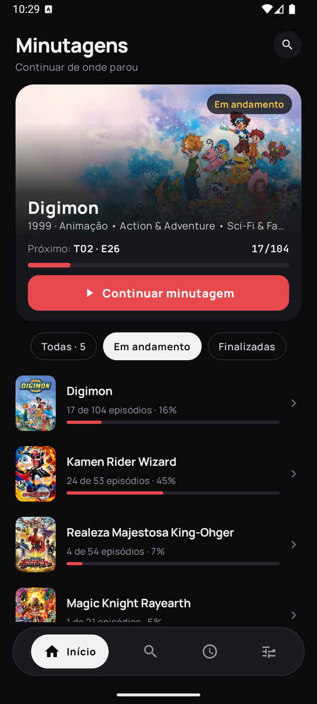
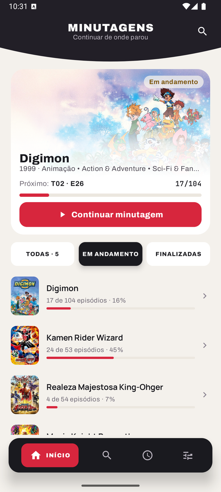
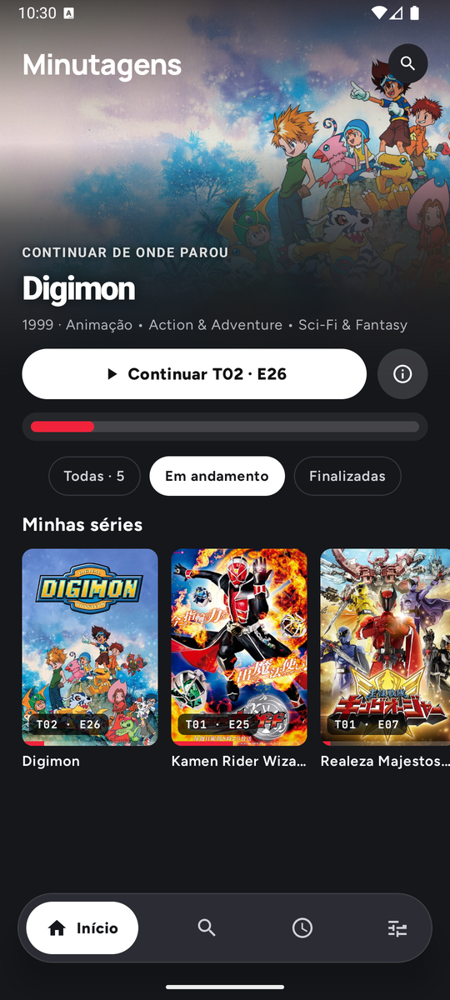
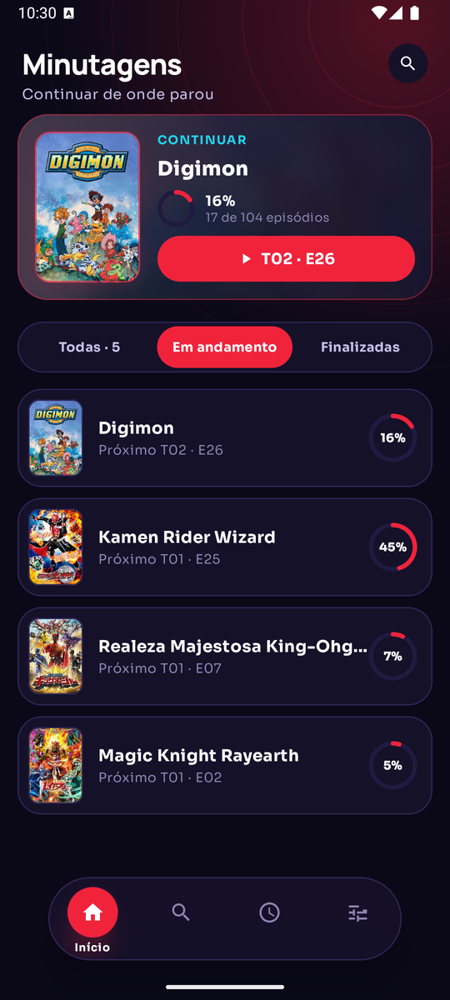
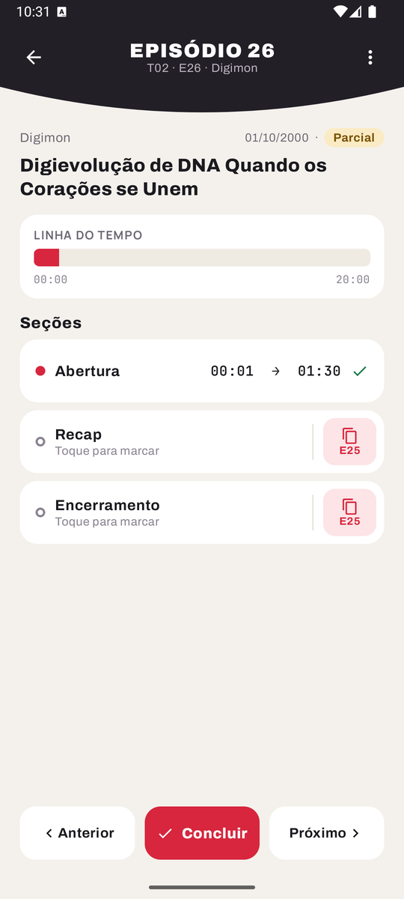
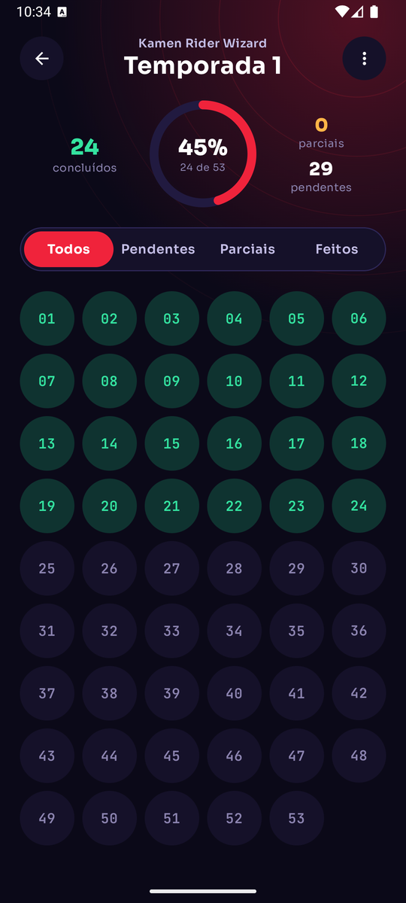
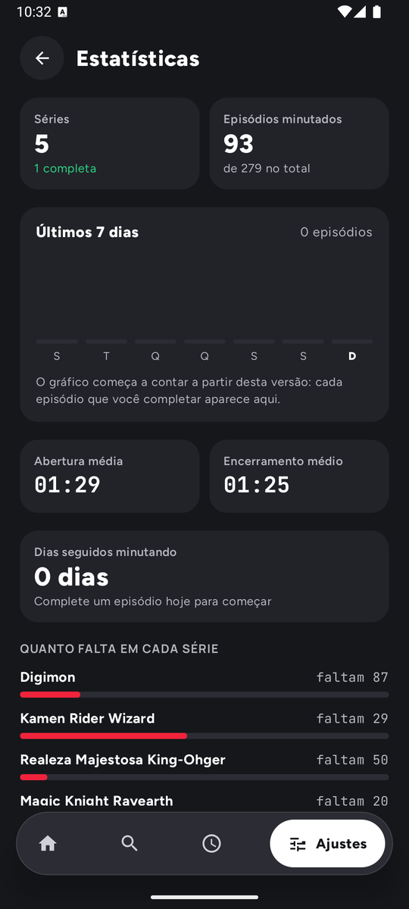

# Banco de Minutagens

**Guarde a abertura, o recap e o encerramento de cada episódio das suas séries.** 
Rápido de preencher, bonito de ver e sempre sincronizado.

---

## O que é

O **Banco de Minutagens** é um app para quem marca os tempos de **abertura**, **recap** e **encerramento** de séries e animes, por exemplo para alimentar o botão "Pular abertura" de players como o Stremio e o Nuvio.

Você adiciona a série pelo nome, o app traz temporadas, episódios, pôsteres e datas do **TMDB**, e você só digita os tempos enquanto assiste.

## Quatro visuais

| Tema A · minimalista | Tema B · claro e quente | Tema C · streaming | Tema D · painel circular |
|:---:|:---:|:---:|:---:|
|  |  |  |  |

| Episódio | Temporada | Estatísticas |
|:---:|:---:|:---:|
|  |  |  |

## Recursos

**Minutagem sem esforço**
- Teclado próprio: digite `130` e vira `01:30`
- "Igual ao anterior" copia a abertura do episódio passado com um toque
- Minutagem fixa: com a duração da abertura definida, o fim é calculado sozinho
- Preenchimento em lote para vários episódios de uma vez
- Aviso quando um tempo parece errado, e **Desfazer** logo depois de salvar
- Modo maratona: ao concluir, já abre o próximo episódio

**Organização**
- Continuar de onde parou, inclusive em episódios que ficaram pela metade
- Status automático da série (Em andamento, Finalizada, Incompleta)
- Aba **Em breve** com contagem para as estreias e aviso no dia
- Estatísticas: progresso, semana, durações médias e quanto falta
- Episódios novos do TMDB avisados na Início

**Seus dados seguros**
- Backup em arquivo, backup automático semanal e lixeira com restauração
- Sincronização opcional com a sua planilha do Google Sheets
- Tudo fica no seu aparelho: chaves e endereços que você configura não saem dele

## Integrações

| | |
|---|---|
| 🎬 **TMDB** | Séries, temporadas, episódios, pôsteres, datas e duração de cada episódio |
| 📊 **Google Sheets** | Exporta, importa e sincroniza as minutagens com a sua planilha |
| ⏭️ **IntroDB** | Envia as suas minutagens para o [introdb.app](https://introdb.app), confere o que já existe lá e importa tempos para as seções vazias |

## Instalar

1. Abra a [última versão](https://github.com/KalidoraBR/banco-de-minutagens/releases/latest) e baixe o arquivo `.apk`.
2. Abra o arquivo no celular. Se o Android pedir, permita instalar apps desta fonte.
3. Pronto. Quando sair uma versão nova, o próprio app avisa na Início.

> Requer Android 8.0 ou mais novo.

## Feito com

Kotlin · Jetpack Compose · Material 3 · Coil · OkHttp · WorkManager

---

Este app usa a API do TMDB, mas não é endossado nem certificado pelo TMDB.

